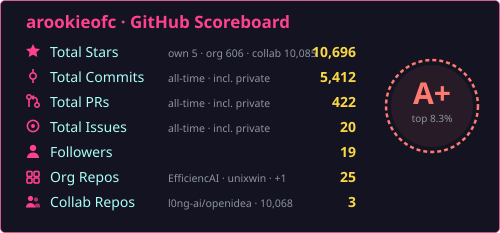
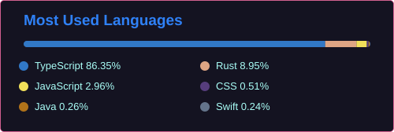

<h1 align="center">你好，我是 arookieofc</h1>

  我在构建 AI 系统、后端平台、Rust 基础设施和开发者工具。

  
  
  

## 关于我

我喜欢写离真实系统更近的软件：模型网关、RAG 检索链路、Agent 工作空间、
分布式后端服务、命令行工具，以及一些为了理解底层机制而从零实现的 Rust 项目。

我的本地工作区里既有偏工程落地的应用，也有学习型项目：Spring Boot 服务、
React / Tauri 前端、LangGraph Agent、Rust 框架实验、C++ Windows 工具和 Python AI 服务。

## 技术栈

  

| 方向 | 技术与主题 |
| --- | --- |
| AI 工程 | RAG、LangGraph、MCP、模型网关、OpenAI 兼容 API |
| 后端开发 | Spring Boot、Fastify、Axum、REST、SSE、JWT、分层架构、DDD |
| 系统编程 | Rust、C++、Shell 工具、命令解析、消息队列、存储实验 |
| 前端开发 | React、TypeScript、Vite、Ant Design、Tauri 桌面应用 |
| 数据与基础设施 | PostgreSQL、pgvector、MySQL、Redis、RabbitMQ、Chroma、SQLite、Docker |

## 代表项目

| 项目 | 简介 |
| --- | --- |
| [advisor-ai-platform](https://github.com/a-rookie-of-C-language/advisor-ai-platform) | 全栈 AI 顾问平台，包含 React 前端、Spring Boot 后端、Python RAG 服务、PostgreSQL、pgvector 和 Ollama 集成。 |
| [ferryllm](https://github.com/arookieofc/ferryllm) | 基于 Rust 和 Tauri 的桌面优先 LLM 网关与启动器，支持 OpenAI / Anthropic / Responses 风格协议路由。 |
| [WinuxCmd](https://github.com/arookieofc/WinuxCmd) | 面向 Windows Shell 的 GNU 风格命令工具集，让 Windows 下的文本管道更接近熟悉的 Unix 工作流。 |
| [AI_Gateway](https://github.com/arookieofc/AI_Gateway) | Rust 实现的模型网关，采用 DDD 分层，支持租户 API Key、限流、流式聊天和 Provider 适配边界。 |
| [rust-spring](https://github.com/arookieofc/rust-spring) | 用 Rust 重新理解 Spring 风格的 IoC、依赖注入、配置系统和注解式宏。 |
| [arookieofcMQ](https://github.com/arookieofc/arookieofcMQ) | 从零实现的 Rust 消息队列学习项目，用来拆解 RocketMQ 等消息中间件的核心概念。 |
| [winuxsh](https://github.com/arookieofc/winuxsh) | Rust 编写的 Windows 上类 Unix Shell，包含补全、主题、历史记录、脚本和插件能力。 |
| [VD_spring](https://github.com/arookieofc/VD_spring) | 志愿时长管理系统，使用 Spring Boot、Spring Security、MyBatis、RabbitMQ、Redis、MySQL 和 Docker。 |
| [WorkBranch](https://github.com/EfficiencAI/WorkBranch) | 基于 LangGraph 多 Agent 编排的 AI 工作空间，支持代码探索、文件操作、任务规划和 React 画布 UI。 |

## 近期关注

- 构建真正能进入工作流的 AI 开发者工具，而不只是停留在 Prompt Demo。
- 把后端系统做得可观测、可测试、可维护。
- 用 Rust 复刻基础设施思想，在实现里理解架构取舍。
- 让 Windows 成为更顺手的一等命令行开发环境。

## GitHub 数据

  
  

  

  Stars = 个人 + 所在组织 + 协作仓库 · commits / PRs / Issues 为全历史（含私有）· 每天由 GitHub Actions 自动刷新 · 等级算法来自 github-readme-stats

  

